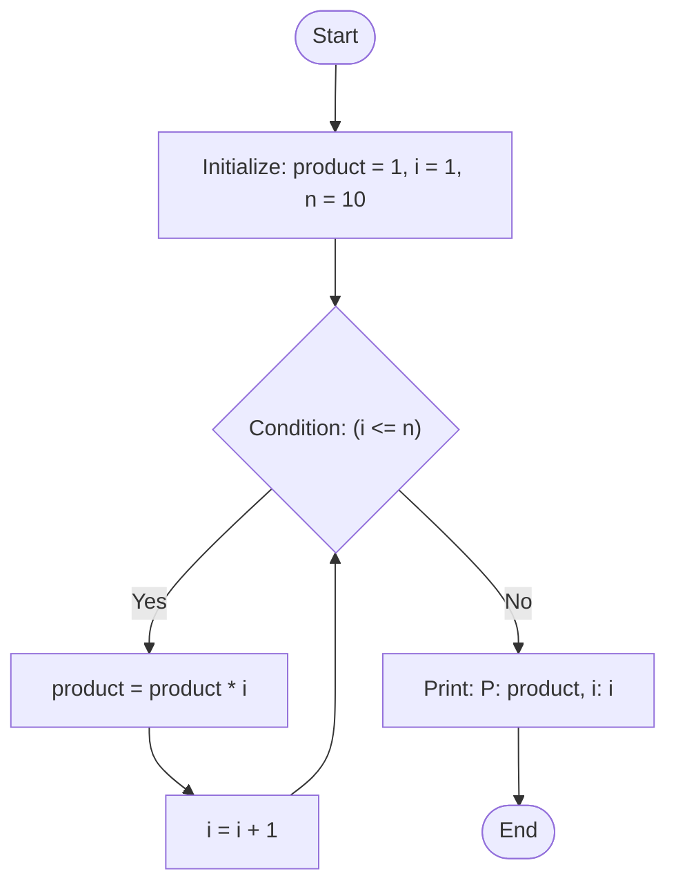
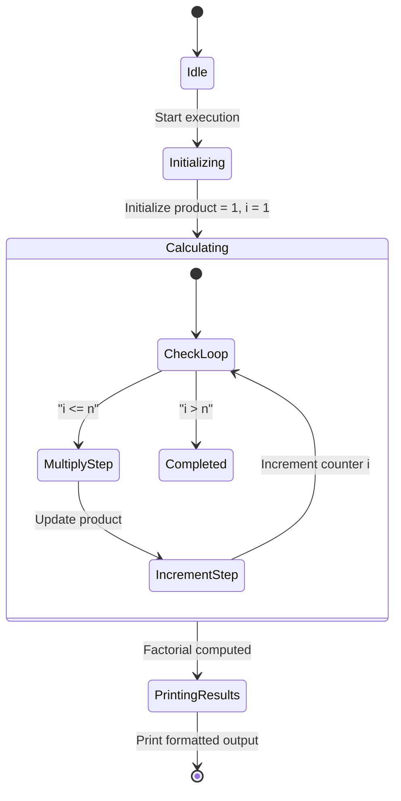
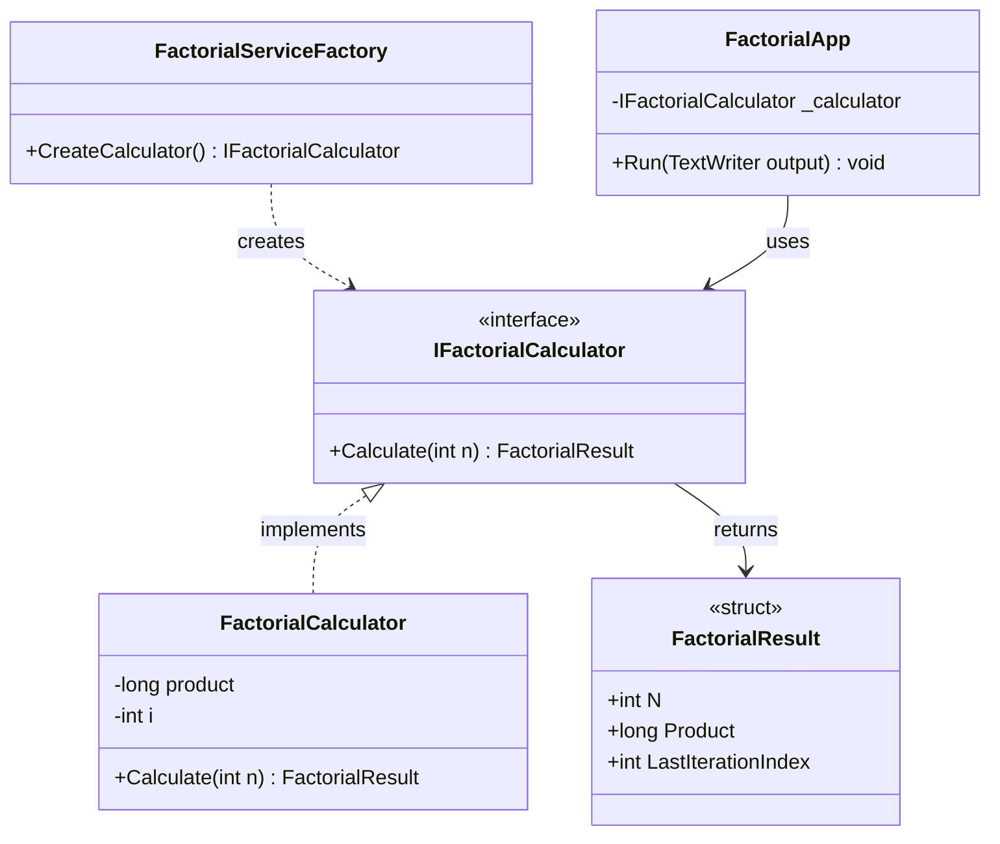

# Lab 1 (Lb1) - Iterative Factorial Computation

## 1. Task Description

The objective of Lab 1 is to implement an iterative algorithm to compute the factorial of a positive integer $n = 10$, as migrated from the canonical `FirstSetupCpp` assignment.

Mathematically, the factorial of a non-negative integer $n$, denoted as $n!$, is defined as:

$$n! = \prod_{k=1}^n k = 1 \times 2 \times 3 \times \dots \times n$$

with the boundary definition:
$$0! = 1$$

For $n = 10$:
$$10! = 1 \times 2 \times 3 \times 4 \times 5 \times 6 \times 7 \times 8 \times 9 \times 10 = 3,628,800$$

The program prints the greeting `"Hello, World!"`, iteratively computes the product $P = 10!$ with an iteration counter $i$, and outputs the final result in the format:
```text
Hello, World!
P: 3628800 i: 11
```

### Constraints and Boundary Rules
- $n \ge 0$: Factorial is defined for non-negative integers.
- $n \le 20$: Factorial calculations for $n > 20$ exceed the capacity of 64-bit signed integers (`long.MaxValue = 9,223,372,036,854,775,807`).

---

## 2. Execution Guide

Run from the repository root or project directory using the .NET CLI:

### Build
```sh
dotnet build Lb1/Lb1.csproj
```

### Run
```sh
dotnet run --project Lb1/Lb1.csproj
```

### Run Unit Tests
```sh
dotnet test Lb1.Tests/Lb1.Tests.csproj
```

---

## 3. Architecture & Diagrams

### Algorithmic Flowchart (`flowchart TD`)



### UML Activity Diagram (`stateDiagram-v2`)



### Structural Diagram (`classDiagram`)


