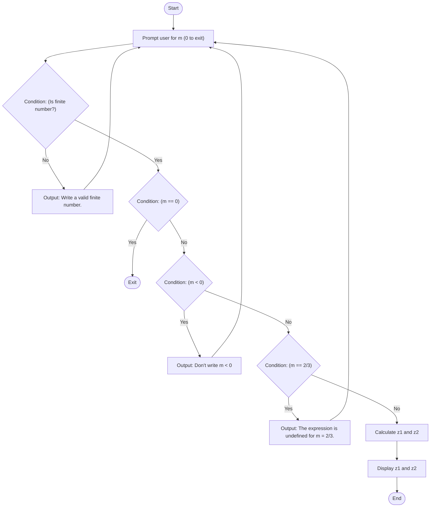
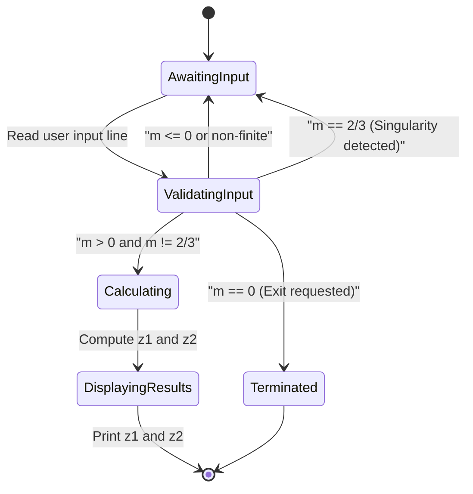
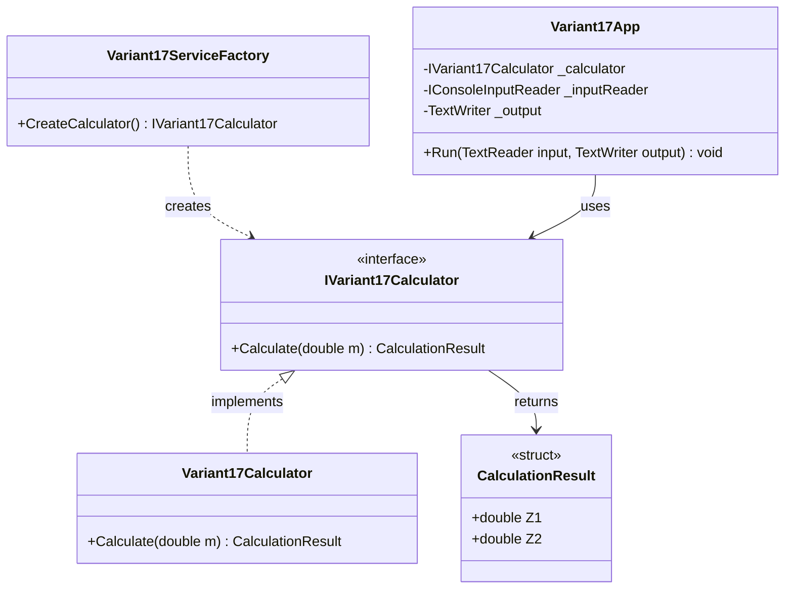

# Lab 2 (Lb2) - Variant 17 Expression Calculation

## 1. Task Description

The objective of Lab 2 (Variant 17) is to evaluate two algebraic expressions, $z_1$ and $z_2$, for a user-supplied real parameter $m$:

$$z_1 = \frac{\sqrt{(3m + 2)^2 - 24m}}{3\sqrt{m} - \frac{2}{\sqrt{m}}}$$

$$z_2 = \sqrt{m}$$

### Mathematical Analysis & Simplification

1. **Numerator Simplification:**
   $$(3m + 2)^2 - 24m = 9m^2 + 12m + 4 - 24m = 9m^2 - 12m + 4 = (3m - 2)^2$$
   Therefore:
   $$\sqrt{(3m + 2)^2 - 24m} = \sqrt{(3m - 2)^2} = |3m - 2|$$

2. **Denominator Simplification:**
   $$3\sqrt{m} - \frac{2}{\sqrt{m}} = \frac{3m - 2}{\sqrt{m}}$$

3. **Relationship between $z_1$ and $z_2$:**
   $$z_1 = \frac{|3m - 2|}{\frac{3m - 2}{\sqrt{m}}} = \frac{|3m - 2|}{3m - 2} \cdot \sqrt{m} = \text{sgn}(3m - 2) \cdot \sqrt{m}$$

   - When $m > \frac{2}{3}$: $3m - 2 > 0 \implies z_1 = \sqrt{m} = z_2$.
   - When $0 < m < \frac{2}{3}$: $3m - 2 < 0 \implies z_1 = -\sqrt{m} = -z_2$.
   - When $m = \frac{2}{3}$: $3m - 2 = 0$, denominator is zero, expression is **undefined** (singularity).

### Input Constraints & Boundary Rules
- $m > 0$: The expression contains $\sqrt{m}$ and division by $\sqrt{m}$, requiring strictly positive numbers.
- $m \ne \frac{2}{3}$: The expression has a removable singularity resulting in division by zero.
- Entering `0` in the console menu prompts an exit from the loop.

---

## 2. Execution Guide

Execute the commands using the .NET CLI from the solution root:

### Build
```sh
dotnet build Lb2/Lb2.csproj
```

### Run
```sh
dotnet run --project Lb2/Lb2.csproj
```

### Run Unit Tests
```sh
dotnet test Lb2.Tests/Lb2.Tests.csproj
```

---

## 3. Architecture & Diagrams

### Algorithmic Flowchart (`flowchart TD`)



### UML Activity Diagram (`stateDiagram-v2`)



### Structural Diagram (`classDiagram`)


