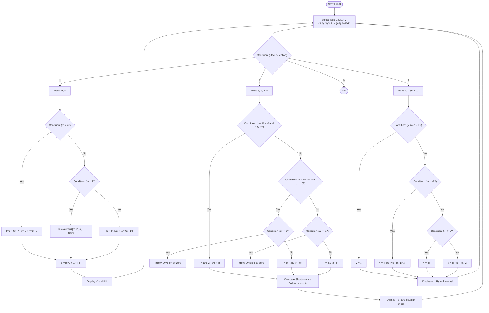
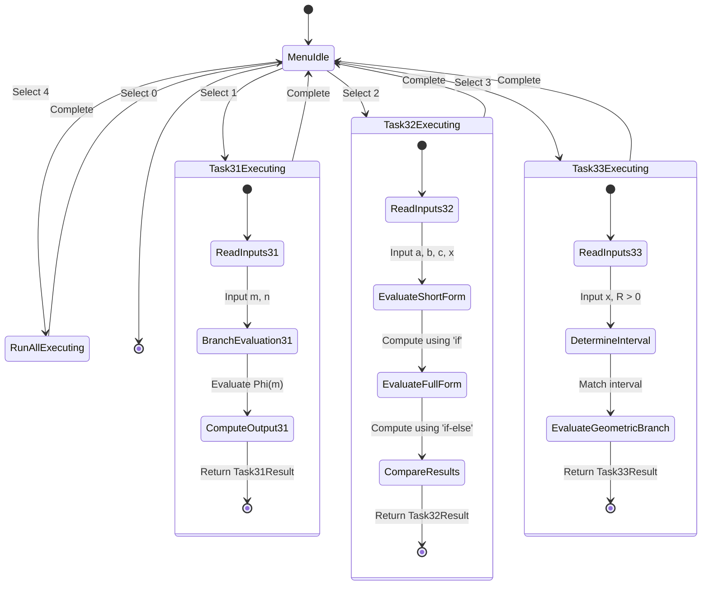
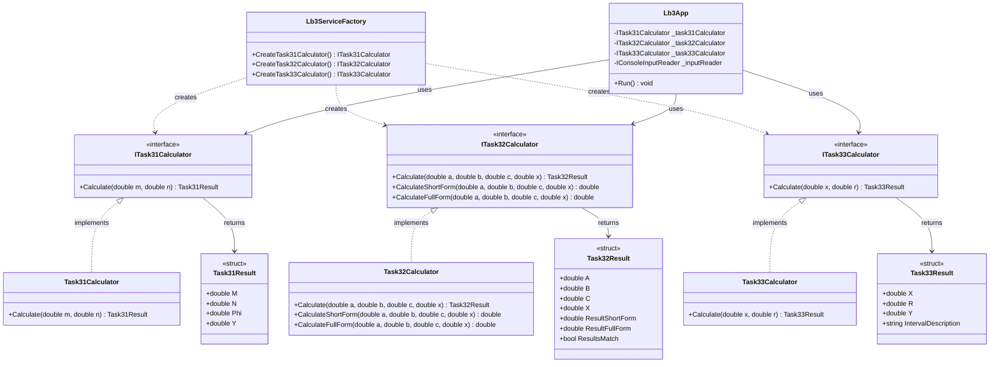

# Lab 3 (Lb3) - Branching Algorithms (Variant 17)

## 1. Task Description

The objective of Laboratory Work 3 is to master algorithmic branching constructs in C#. The assignment consists of three distinct sub-tasks unified in a modular console application.

---

### Task 3.1: Piecewise Function of a Single Variable

Calculates the function $Y = m^2 + 1 + \Phi(m)$ for user-entered real arguments $m$ and $n$, where $\Phi(m)$ is defined piecewise:

$$\Phi(m) = \begin{cases} 4m^7 - m^5 + m^3 - 2, & m < 4 \\ \arctan\left(\frac{|m| + 1}{2}\right) + 8.3m, & 4 \le m < 7 \\ \ln(|2m + e^{4m + 1}|), & m \ge 7 \end{cases}$$

---

### Task 3.2: Parameterized Branching Function

Calculates $F(x)$ given real parameters $a$, $b$, $c$ and argument $x$:

$$F(x) = \begin{cases} ax^2 - cx + b, & x + 10 < 0 \text{ and } b \ne 0 \\ \frac{x - a}{x - c}, & x + 10 > 0 \text{ and } b = 0 \\ -\frac{x}{a - c}, & \text{otherwise} \end{cases}$$

#### Implementation Requirement:
The algorithm is evaluated simultaneously using two branching forms:
1. **Short-form branching:** using strictly `if` statements without `else`.
2. **Full-form branching:** using `if ... else if ... else` structures.

The results of both methods must match. Special care is taken to handle singularities where denominators $(x - c)$ or $(a - c)$ vanish.

---

### Task 3.3: Graph-Based Piecewise Function

Calculates the function $y(x, R)$ given argument $x$ and scale/radius parameter $R > 0$, partitioned across four geometric intervals:

$$y = \begin{cases} 1, & x \le -1 - R \\ -\sqrt{R^2 - (x + 1)^2}, & -1 - R < x \le -1 \\ -R, & -1 < x \le 2 \\ \frac{R(x - 4)}{2}, & x > 2 \end{cases}$$

#### Geometric Analysis:
- **Interval 1 ($x \le -1 - R$):** Constant horizontal line $y = 1$.
- **Interval 2 ($-1 - R < x \le -1$):** Lower circular arc of radius $R$ centered at $(-1, 0)$.
- **Interval 3 ($-1 < x \le 2$):** Constant horizontal line $y = -R$.
- **Interval 4 ($x > 2$):** Linear ray passing through $(2, -R)$ and intersecting the x-axis at $(4, 0)$.

---

## 2. Execution Guide

Execute commands from the repository root using the .NET CLI:

### Build
```sh
dotnet build Lb3/Lb3.csproj
```

### Run
```sh
dotnet run --project Lb3/Lb3.csproj
```

### Run Unit Tests
```sh
dotnet test Lb3.Tests/Lb3.Tests.csproj
```

---

## 3. Architecture & Diagrams

### Algorithmic Flowchart (`flowchart TD`)



### UML Activity Diagram (`stateDiagram-v2`)



### Structural Diagram (`classDiagram`)


