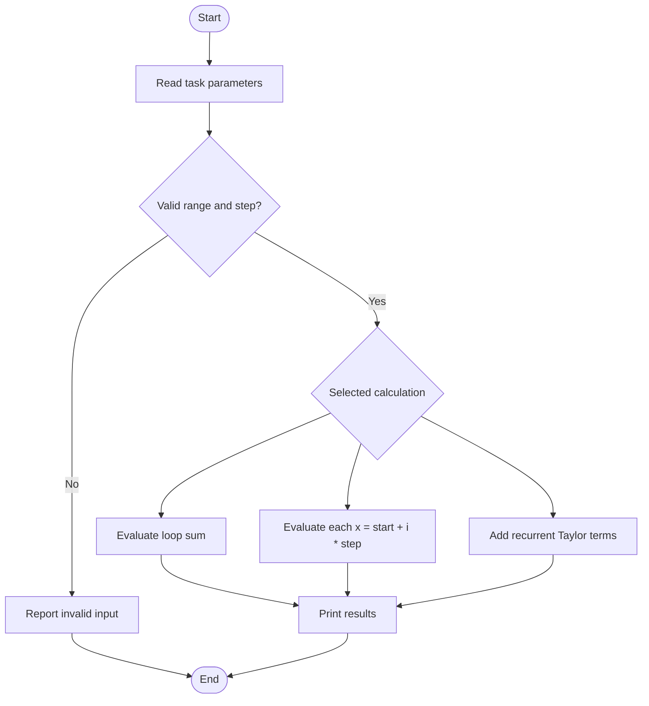
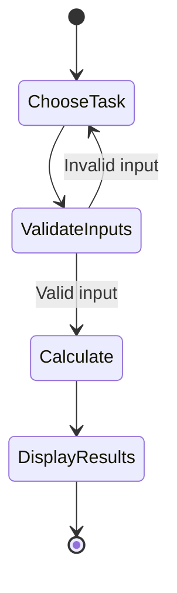
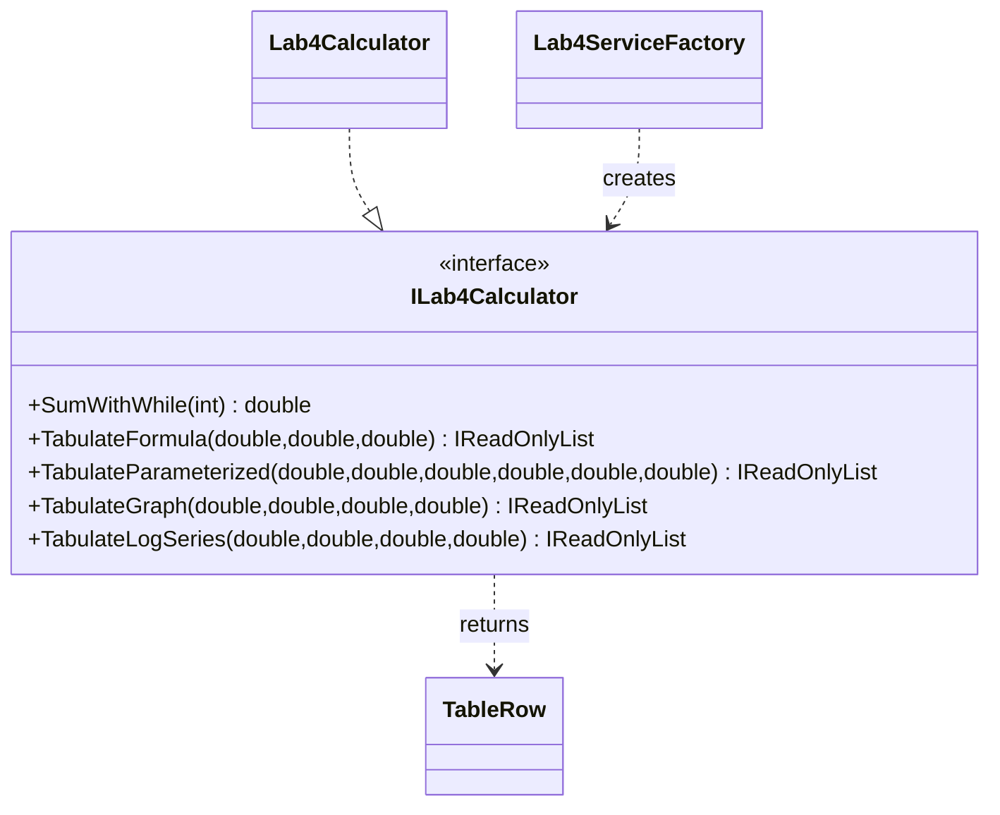

# Lab 4 — Loops and Function Tabulation

## Tasks

This module implements the Variant 17 loop exercises: the same trigonometric sum in four loop forms (4.1), formula/parameter/graph tabulation (4.2–4.4), four nested-loop forms (4.6), and the recurrent Taylor series for `ln(x)` (4.7). Service methods validate ranges, calculate points as `start + i * step`, and represent undefined values as `NaN` or a missing series result.

Task 4.5 is intentionally not fabricated: its task statement says the target diagram and the inequalities defining the shaded region are unavailable. The application identifies this blocker; `InTarget(x,y,R)` cannot be correct until the region is specified.

## Run and test

```sh
dotnet build Lb4/Lb4.csproj
dotnet run --project Lb4/Lb4.csproj
dotnet test Lb4.Tests/Lb4.Tests.csproj
```

## Algorithm flowchart



## UML activity diagram



## Structure


