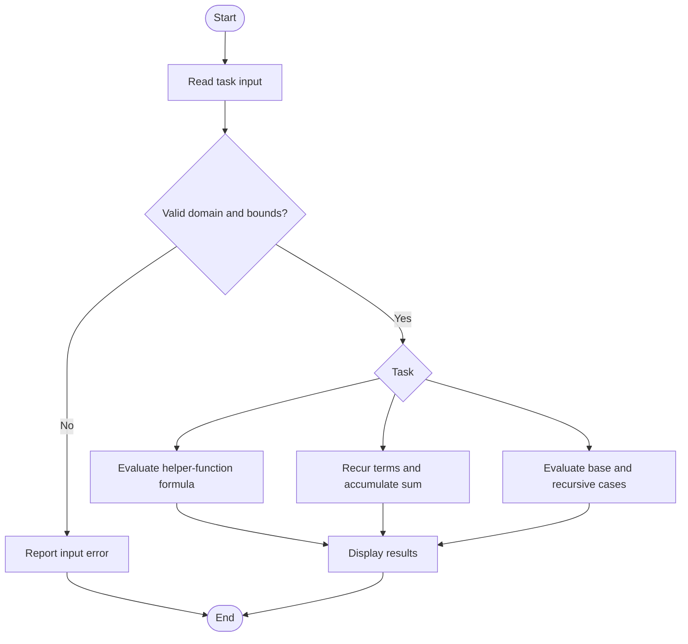
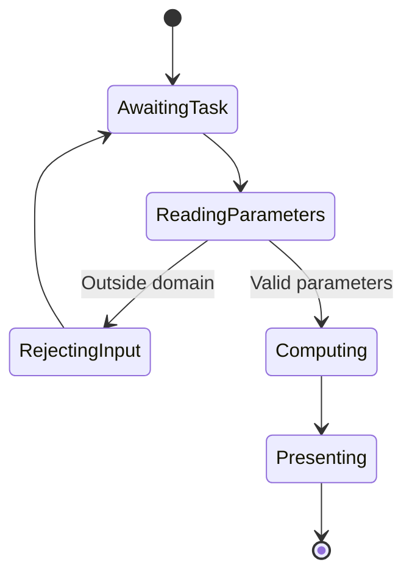
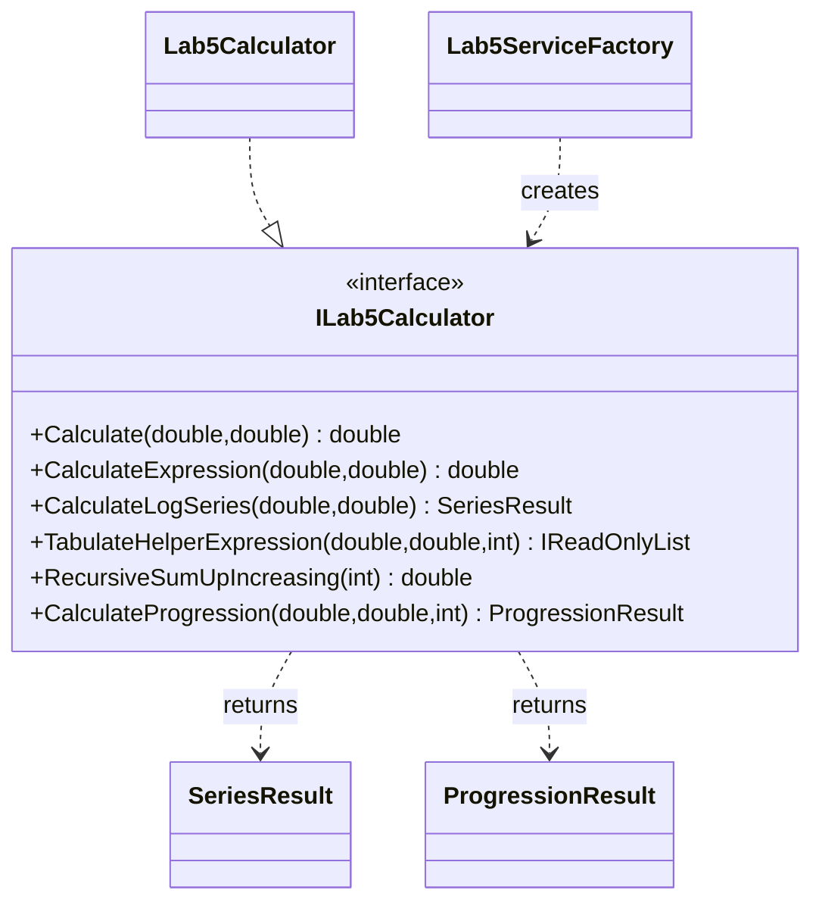

# Lab 5 — Functions and Recursion

## Tasks

The calculator implements the introductory isolated calculation (5.0: `calculate(x, y) = (x^2 + y) / 2.0`), the rational helper-function expression (5.1), the logarithm Taylor series and its recurrent term calculation (5.2), the six-term piecewise helper and nested table expression (5.3), five iterative/recursive implementations of the trigonometric sum (5.4), and recursive geometric-progression term/sum calculations with call-chain depths (5.5). Series routines validate their convergence domains and include the terminal term below epsilon. The stated check `h(0.5) ≈ 1.2553` conflicts with the specified sum `sum(x^i/(2i)!, i=0..5)`; evaluating that exact six-term formula gives approximately `1.2605918`, which is implemented.

## Run and test

```sh
dotnet build Lb5/Lb5.csproj
dotnet run --project Lb5/Lb5.csproj
dotnet test Lb5.Tests/Lb5.Tests.csproj
```

## Algorithm flowchart



## UML activity diagram



## Structure


