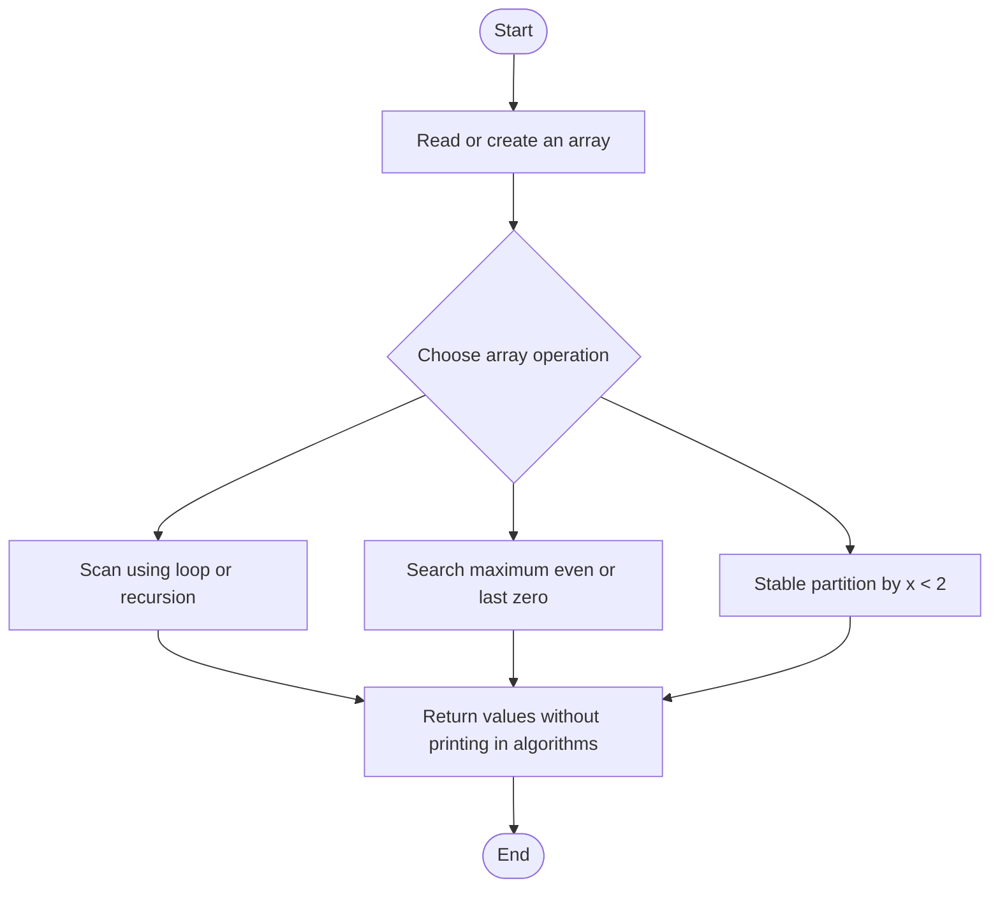
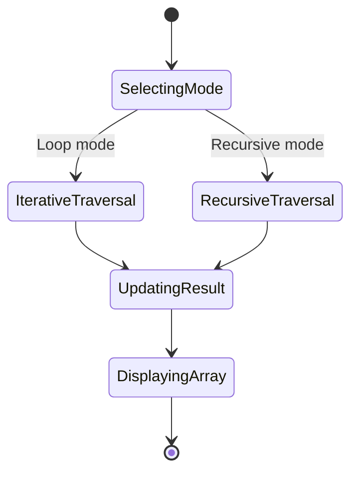
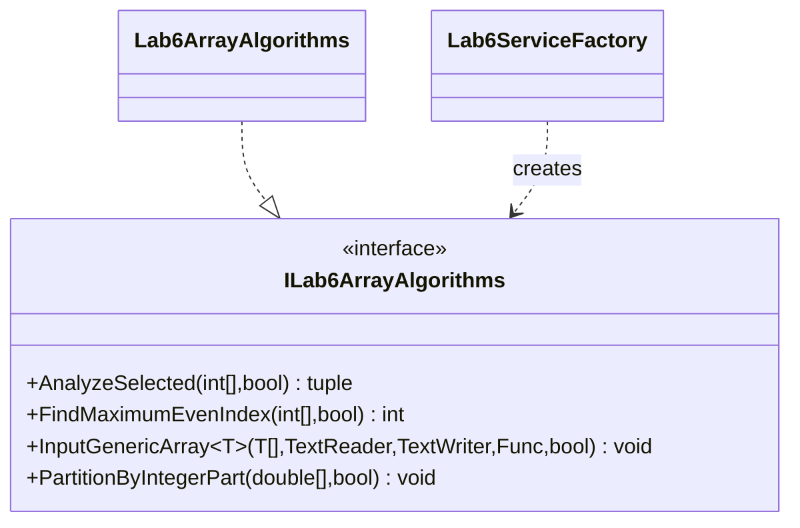

# Lab 6 — Array Processing

## Tasks

Lab 6 exposes iterative and recursive forms for the selected-element array scan (6.1), maximum-even-index search (6.2), ordinary and generic array input (6.3), and dynamic-array statistics plus stable partitioning (6.4). Recursive alternatives use an explicit index parameter. The 6.4 stable partition groups values `x < 2` before values `x >= 2`; the last-zero search returns `-1` when no zero exists.

## Run and test

```sh
dotnet build Lb6/Lb6.csproj
dotnet run --project Lb6/Lb6.csproj
dotnet test Lb6.Tests/Lb6.Tests.csproj
```

## Algorithm flowchart



## UML activity diagram



## Structure


