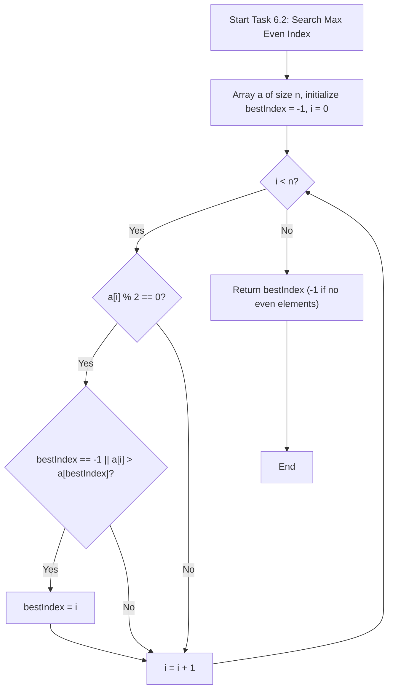
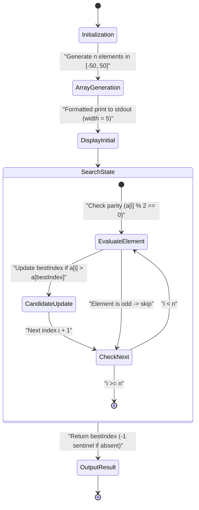
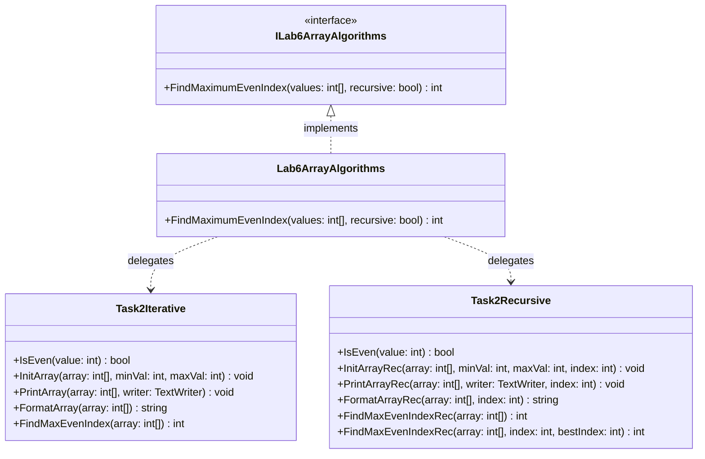

# Lab 6 — One-Dimensional Arrays (C# / .NET)

Modular .NET solution demonstrating one-dimensional array algorithms implemented via both iterative loops and pure recursive techniques.

## Subtasks Overview

1. **Task 6.1 (Variant 17): Array Selection, Counting, Summing, and Zeroing**
   - **Data Domain:** 25 integer elements with uniform distribution in $[4, 73]$.
   - **Selection Criterion:** $(r_i \bmod 6 = 0) \lor (i \bmod 5 \neq 0)$.
   - **Invariants:**
     - Matching element count: $20 \le K \le 25$.
     - Cumulative sum: $80 \le S \le 1825$.
     - Execution sequence: $\text{Generate} \to \text{Print} \to (\text{Count}, \text{Sum}) \to \text{Zero} \to \text{Print}$.
   - **Decomposition (Single Responsibility):** Independent pure methods in `Task1Iterative` and `Task1Recursive` (`GenerateArray`, `PrintArray`, `CountElements`, `SumElements`, `ZeroElements`).

2. **Task 6.2 (Variant 17): Search for the Index of the Maximum Even Element**
   - **Data Domain:** One-dimensional array $a = (a_0, a_1, \dots, a_{n-1})$ of arbitrary dimension $n \ge 1$ with $a_i \in [-50, 50]$.
   - **Evenness Predicate:** $P(x) \iff (x \bmod 2 = 0)$ (correctly handles positive evens, negative evens, and zero: $0 \bmod 2 = 0$).
   - **Solution Existence & Tie-Breaking:**
     - If no even numbers exist ($I_{\text{even}} = \varnothing$), returns sentinel value $k^* = -1$.
     - If duplicates of the maximum even value exist, returns the first occurrence (smallest index): $k^* = \min \{ i \in I_{\text{even}} \mid a_i = \max_{j \in I_{\text{even}}} a_j \}$.
   - **Decomposition (Single Responsibility):** Independent pure methods in `Task2Iterative` and `Task2Recursive` (`IsEven`, `InitArray`, `PrintArray`, `FindMaxEvenIndex` and recursive equivalents `InitArrayRec`, `PrintArrayRec`, `FindMaxEvenIndexRec`).

3. **Task 6.3:** Ordinary and generic input handlers reading typed values from `TextReader`.
4. **Task 6.4:** Dynamic array manipulation: positive count, sum after last zero, and stable partition around value $2.0$.

## Execution Guide

Build, run, and test the project using the standard .NET CLI:

```bash
# Build the project
dotnet build Lb6/Lb6.csproj

# Run interactive console application
dotnet run --project Lb6/Lb6.csproj

# Execute test suite
dotnet test Lb6.Tests/Lb6.Tests.csproj
```

## Diagrams (Mermaid.js)

### Flowchart (`flowchart TD`)



### Activity / State Diagram (`stateDiagram-v2`)



### Class Diagram (`classDiagram`)


