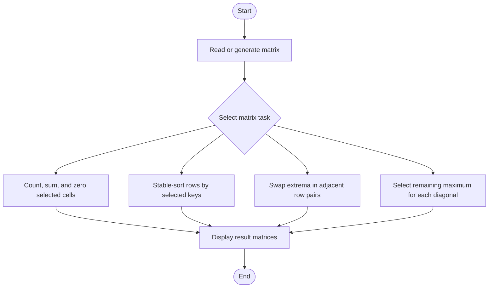
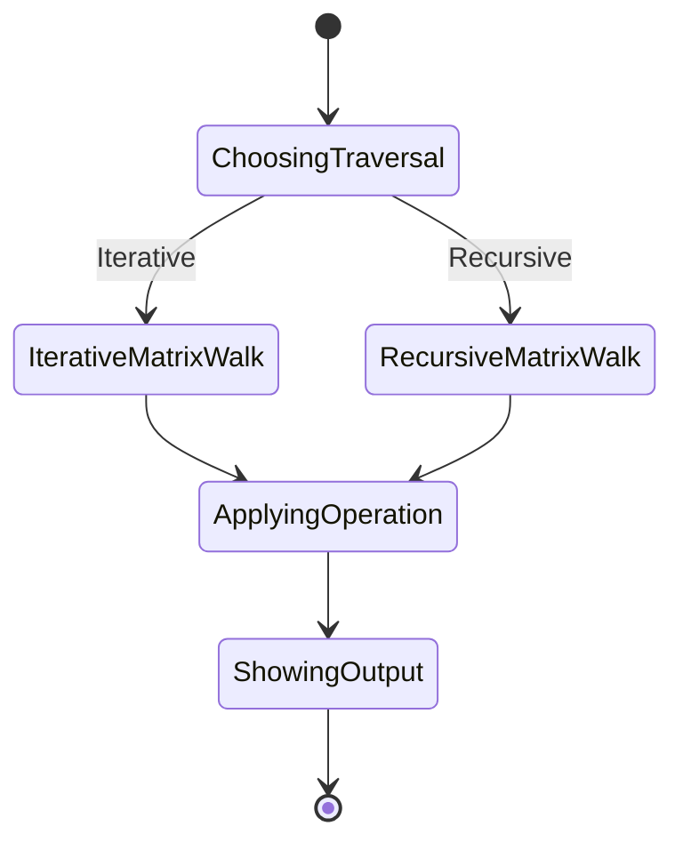
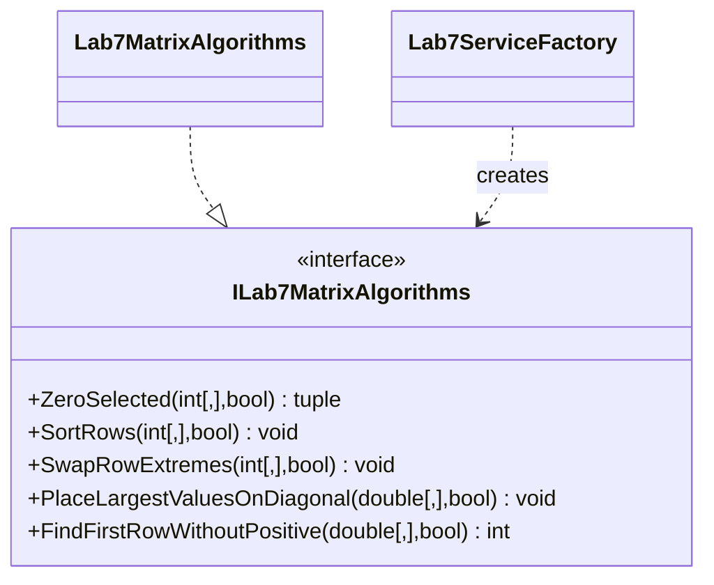

# Lab 7 — Matrix Algorithms

## Tasks

The module provides iterative and recursive matrix variants for the non-multiple-of-six scan and zeroing (7.1), row-pair minimum/maximum swaps (7.2), and largest-value diagonal placement plus first non-positive row lookup (7.3). Rows are stably ordered by columns 1, 2, and 4 (one-based), and the diagonal stage breaks ties in row-major order.

## Run and test

```sh
dotnet build Lb7/Lb7.csproj
dotnet run --project Lb7/Lb7.csproj
dotnet test Lb7.Tests/Lb7.Tests.csproj
```

## Algorithm flowchart



## UML activity diagram



## Structure


